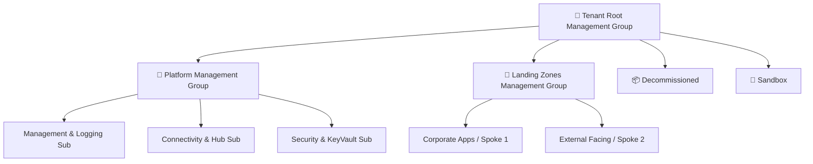

# 🌐 Enterprise Azure Landing Zone & Governance

[](https://azure.microsoft.com/)
[](https://www.terraform.io/)
[](https://learn.microsoft.com/en-us/azure/cloud-adoption-framework/)
[](https://azure.microsoft.com/)

---

## 📌 Overview

This repository implements an **Enterprise Azure Landing Zone** aligned with the **Microsoft Cloud Adoption Framework (CAF)**. It establishes centralized management, governance, security guardrails, and network boundaries required to host enterprise workloads safely in Microsoft Azure.

### Key Architectural Pillars
* 🏢 **Management Group Hierarchy**: Structured organization of subscriptions into Core, Platform, and Landing Zones.
* 🛡️ **Azure Policy & Guardrails**: Automated enforcement of regulatory compliance, encryption, region restrictions, and tagging standards.
* 🔐 **Identity & Access Management**: Principle of Least Privilege via Azure RBAC, Privileged Identity Management (PIM), and Microsoft Entra ID integration.
* 🌐 **Connectivity & Hybrid Networking**: Centralized Hub network supporting Azure Firewall, Bastion, and ExpressRoute / VPN Gateways.
* 📊 **Centralized Observability**: Central Log Analytics Workspace collecting resource diagnostic logs and security event data.

---

## 🏛️ Landing Zone Hierarchy Blueprint



---

## 🚀 Deployment Instructions

```bash
# 1. Initialize Terraform
terraform init

# 2. Review Execution Plan
terraform plan -out=landingzone.tfplan

# 3. Apply Landing Zone
terraform apply landingzone.tfplan
```

---

## 👨‍💻 Author

**Md Irshad Alam**  
*Senior Azure DevOps Engineer & Multi-Cloud Platform Architect*  
* 💼 **LinkedIn:** [linkedin.com/in/md-irshad-alam-0a5278220](https://www.linkedin.com/in/md-irshad-alam-0a5278220)  
* 📬 **Email:** `mdirshadalam91190@gmail.com`  
